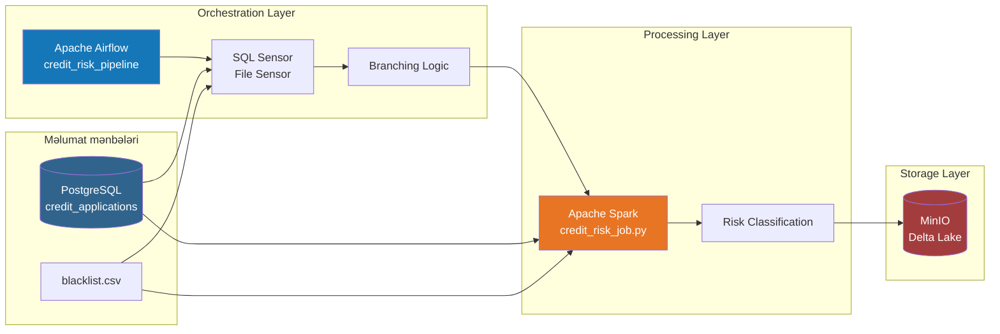
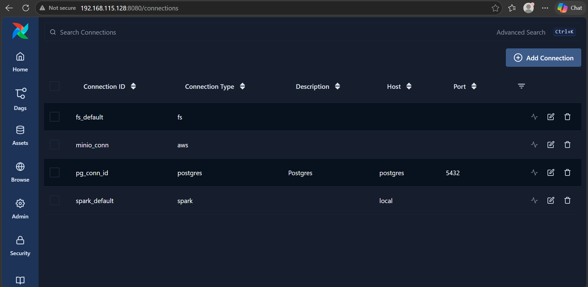
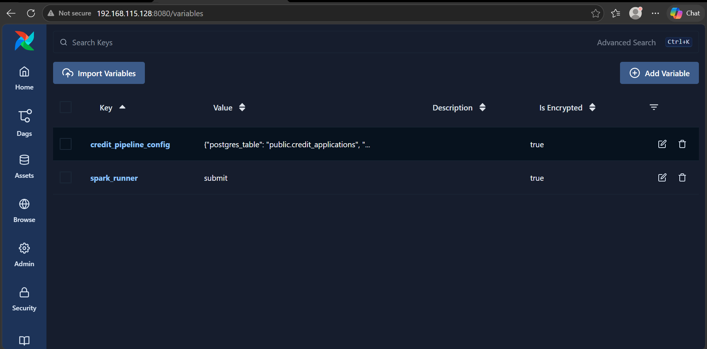
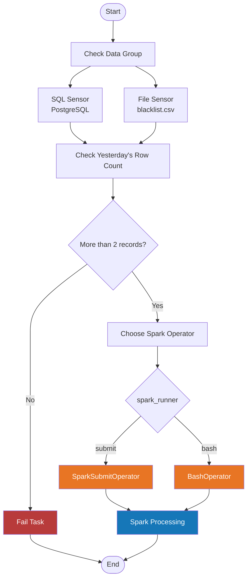
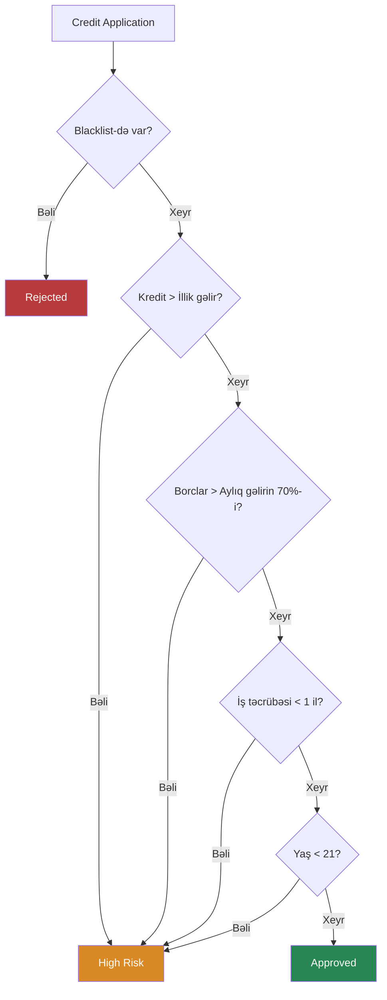
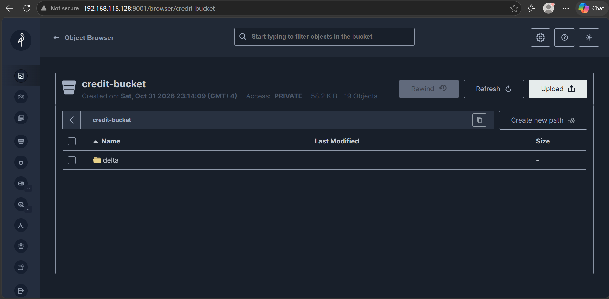
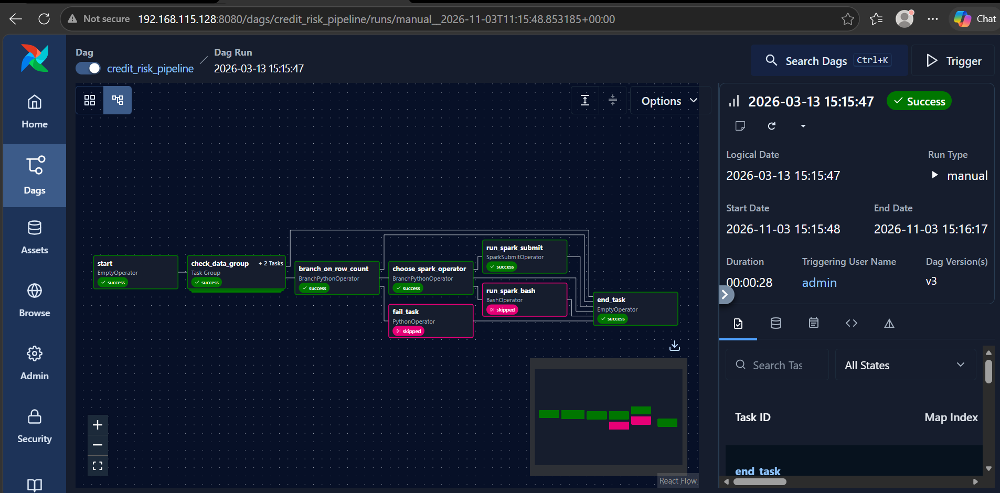
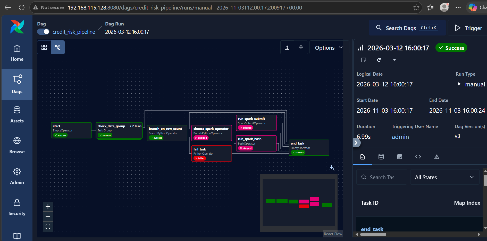

# Credit Risk Data Pipeline

Apache Airflow, Apache Spark, PostgreSQL, MinIO və Delta Lake istifadə edilərək hazırlanmış avtomatlaşdırılmış Kredit Risk Analizi layihəsi.

Bu layihənin məqsədi PostgreSQL-dən kredit müraciətlərini əldə etmək, onları qara siyahı (blacklist) məlumatları ilə birləşdirmək, müəyyən edilmiş biznes qaydalarına əsasən risk statuslarını təyin etmək və nəticələri MinIO-da Delta Lake formatında saxlamaqdır.

---

## 1. Ümumi baxış

Layihə məlumatların əldə edilməsindən emalına və saxlanmasına qədər tam Data Engineering prosesini əhatə edir.

### Əsas xüsusiyyətlər

- Apache Airflow vasitəsilə iş axınının idarə edilməsi.
- PostgreSQL-dən Spark JDBC vasitəsilə məlumatların oxunması.
- SQL Sensor və File Sensor ilə məlumatların mövcudluğunun yoxlanılması.
- BranchPythonOperator vasitəsilə şərtli keçidlərin idarə edilməsi.
- PySpark ilə kredit risklərinin hesablanması.
- MinIO ilə S3-compatible inteqrasiya.
- Delta Lake formatında məlumatların saxlanılması.
- `application_date` sütununa görə partitioning.
- SparkSubmitOperator və BashOperator arasında dinamik seçim.
- Uğursuz icraların idarə edilməsi.

## 2. Arxitektura

Aşağıdakı diaqram layihənin ümumi arxitekturasını və komponentlər arasındakı məlumat axınını göstərir.



### Məlumat axınının mərhələləri

1. Airflow DAG işə düşür.
2. SQL Sensor PostgreSQL-də dünənki kredit müraciətlərinin mövcudluğunu yoxlayır.
3. File Sensor `blacklist.csv` faylının mövcudluğunu yoxlayır.
4. BranchPythonOperator məlumat sayını yoxlayaraq növbəti mərhələni müəyyən edir.
5. Spark işi seçilmiş operator vasitəsilə başladılır.
6. Spark PostgreSQL və blacklist məlumatlarını oxuyur.
7. Kredit müraciətlərinə risk statusu təyin edilir.
8. Nəticələr MinIO-da Delta Lake formatında saxlanılır.

## 3. İstifadə olunan texnologiyalar

| Texnologiya | İstifadə məqsədi |
|---|---|
| Apache Airflow 3.1.0 | İş axınının idarə edilməsi |
| Apache Spark 3.5.3 | Məlumatların emalı |
| PostgreSQL 16 | Məlumat mənbəyi |
| MinIO | Obyekt saxlama sistemi |
| Delta Lake 3.2.0 | Məlumatların saxlanılması |
| Docker Compose | Servislərin idarə edilməsi |
| Python | Pipeline və transformasiya kodları |
| SQL | Cədvəllərin yaradılması və məlumatların əlavə edilməsi |

## 4. Layihənin strukturu

```text
credit-risk-pipeline/
│
├── airflow/
│   ├── dags/
│   │   └── credit_risk_pipeline.py
│   │
│   ├── spark_jobs/
│   │   └── credit_risk_job.py
│   │
│   └── data/
│       └── blacklist.csv
│
├── sql/
│   └── create_and_insert.sql
│
├── screenshots/
│   ├── airflow_conn.png
│   ├── airflow_variables.png
│   ├── graph_success.png
│   ├── graph_fail.png
│   └── minio_delta.png
│
├── Dockerfile
├── docker-compose.yml
├── requirements.txt
├── .env.example
└── README.md
```

## 5. İnfrastrukturun qurulması

Layihənin servisləri Docker Compose vasitəsilə idarə olunur.

İnfrastruktur aşağıdakı komponentlərdən ibarətdir:

- **PostgreSQL:** Kredit müraciətlərinin saxlanılması və Airflow metadata bazası.
- **Airflow API Server:** Airflow Web UI interfeysinin təqdim edilməsi.
- **Airflow Scheduler:** DAG-ların və task-ların icrasının idarə edilməsi.
- **Airflow DAG Processor:** DAG fayllarının oxunması və emalı.
- **MinIO:** Spark tərəfindən emal edilmiş məlumatların saxlanılması.

### Dockerfile

Custom Airflow image Apache Airflow 3.1.0 əsasında hazırlanıb.

Əlavə olaraq aşağıdakı sistem paketləri quraşdırılır:

- OpenJDK 17
- Git
- Bash
- cURL
- Unzip

Python asılılıqları `requirements.txt` vasitəsilə quraşdırılır.

### Docker Compose

Bütün servislər `lake` adlı ortaq Docker bridge network daxilində işləyir.

PostgreSQL və MinIO məlumatlarının konteynerlər yenidən başladıldıqda qorunması üçün persistent volumes istifadə olunur.

### Environment Variables

Konfiqurasiya məlumatları `.env` faylında saxlanılır.

İlk olaraq nümunə fayldan `.env` yaradılır:

```bash
cp .env.example .env
```

Daha sonra müvafiq istifadəçi adları, şifrələr və digər konfiqurasiya dəyişənləri doldurulur.

**Qeyd:** `.env` faylı GitHub-a yüklənməməlidir. Yalnız `.env.example` paylaşılır.

## 6. PostgreSQL məlumat bazasının hazırlanması

Layihənin əsas məlumat mənbəyi PostgreSQL-dir.

`sql/create_and_insert.sql` faylı vasitəsilə `credit_applications` cədvəli yaradılır və nümunə kredit müraciətləri əlavə edilir.

### Cədvəlin strukturu

```sql
CREATE TABLE credit_applications (
    application_id INT PRIMARY KEY,
    customer_id VARCHAR(10),
    customer_name VARCHAR(100),
    requested_amount NUMERIC(12,2),
    monthly_income NUMERIC(12,2),
    existing_debt NUMERIC(12,2),
    employment_years NUMERIC(4,1),
    age INT,
    application_date DATE
);
```

Cədvəldə aşağıdakı məlumatlar saxlanılır:

- Müştərinin ID-si və adı.
- Tələb olunan kredit məbləği.
- Aylıq gəlir.
- Mövcud borc.
- İş təcrübəsi.
- Müştərinin yaşı.
- Müraciət tarixi.

Blacklist məlumatları isə ayrıca CSV faylında saxlanılır.

**Qeyd:** Spark JDBC bağlantısında `credit_db` istifadə edilir. Buna görə PostgreSQL-də bu baza ayrıca yaradılmalı və SQL skripti həmin bazada icra edilməlidir.

## 7. Airflow konfiqurasiyası

Airflow Connections və Variables vasitəsilə xarici servislərlə bağlantılar və pipeline parametrləri idarə olunur.

### 7.1. Airflow Connections



Layihədə aşağıdakı bağlantılardan istifadə olunur:

| Connection ID | Təyinatı |
|---|---|
| `pg_conn_id` | PostgreSQL bağlantısı |
| `minio_conn` | MinIO giriş məlumatları |
| `spark_default` | Spark bağlantısı |
| `fs_default` | Fayl sistemi bağlantısı |

Bu bağlantılar istifadəçi adı, şifrə və digər məlumatları DAG kodunda birbaşa yazmadan servislərlə əlaqə yaratmağa imkan verir.

### 7.2. Airflow Variables



Pipeline-ın davranışını idarə etmək üçün iki əsas Variable istifadə olunur.

**credit_pipeline_config**

PostgreSQL-də oxunacaq cədvəlin adını saxlayır.

Nümunə:

```json
{
    "postgres_table": "public.credit_applications"
}
```

**spark_runner**

Spark işinin hansı üsulla başladılacağını müəyyən edir.

İki mümkün dəyəri var:

- `submit` – SparkSubmitOperator istifadə edilir.
- `bash` – BashOperator istifadə edilir.

Beləliklə, DAG kodunu dəyişmədən Spark-ın icra üsulunu dəyişmək mümkündür.

## 8. Airflow DAG – Pipeline idarəetməsi

Əsas iş axını `airflow/dags/credit_risk_pipeline.py` faylında yerləşir.

### DAG Workflow



### 8.1. Məlumatların yoxlanılması

DAG daxilində iki Sensor `check_data_group` adlı TaskGroup altında yerləşir.

**SQL Sensor**

PostgreSQL-də dünənə aid kredit müraciətlərinin olub-olmadığını yoxlayır.

- `mode="reschedule"`
- `poke_interval=10`
- `timeout=60`

**File Sensor**

Blacklist CSV faylının mövcudluğunu yoxlayır.

Faylın yolu:

```text
/opt/airflow/data/blacklist.csv
```

Bu Sensor da `reschedule` rejimində işləyir.

### 8.2. Branching Logic

Sensorlar uğurla tamamlandıqdan sonra `BranchPythonOperator` dünənə aid məlumatların sayını yoxlayır.

| Şərt | Nəticə |
|---|---|
| Sətir sayı 2-dən çoxdur | Spark mərhələsinə keçid |
| Sətir sayı 2 və ya daha azdır | Fail Task |

Məlumat sayı tələb olunan şərti ödəmədikdə `AirflowFailException` vasitəsilə DAG uğursuz dayandırılır.

### 8.3. Spark Operator seçimi

İkinci `BranchPythonOperator` `spark_runner` Variable dəyərinə əsasən operator seçir.

- `submit` → SparkSubmitOperator
- `bash` → BashOperator

Hər iki operator eyni Spark Python faylını icra edir.

### 8.4. End Task və Trigger Rule

DAG-ın sonunda `EmptyOperator` istifadə olunur:

```python
end_task = EmptyOperator(
    task_id="end_task",
    trigger_rule=TriggerRule.ALL_DONE
)
```

**Sual: `end_task`-da niyə `ALL_DONE` seçilib?**

`ALL_DONE` seçilib, çünki `end_task` əvvəlki task-ların uğurlu və ya uğursuz olmasından asılı olmayaraq, onların hamısı tamamlandıqdan sonra icra olunmalıdır. Branching zamanı seçilməyən task-lar `skipped` statusu ala bilər. Standart `ALL_SUCCESS` qaydası bu halda son task-ın icrasına mane ola bilər. `ALL_DONE` isə həm uğurlu, həm uğursuz, həm də skipped nəticələrdən sonra yekun task-ın işləməsinə imkan verir.

## 9. PySpark ilə kredit risklərinin hesablanması

Məlumatların transformasiya məntiqi `airflow/spark_jobs/credit_risk_job.py` faylında yerləşir.

### 9.1. Məlumatların oxunması

Spark PostgreSQL-dən JDBC vasitəsilə kredit müraciətlərini oxuyur.

Blacklist CSV faylı isə əvvəlcədən təyin edilmiş schema ilə oxunur.

### 9.2. Məlumatların birləşdirilməsi

Hər iki dataset `customer_id` sütunu əsasında `left join` ilə birləşdirilir.

```python
join_df = credit_df.join(
    blacklist_df,
    on="customer_id",
    how="left"
)
```

`left join` bütün kredit müraciətlərinin nəticədə saxlanılmasını təmin edir.

### 9.3. Kredit risklərinin müəyyən edilməsi

Hər kredit müraciətinə müəyyən edilmiş biznes qaydalarına əsasən risk statusu təyin edilir.

#### Risk Classification Workflow



#### Risk qaydaları

| Şərt | Risk statusu |
|---|---|
| Müştəri blacklist-də mövcuddur | Rejected |
| Kredit məbləği aylıq gəlirin 12 mislindən çoxdur | High Risk |
| Mövcud borc aylıq gəlirin 70%-dən çoxdur | High Risk |
| İş təcrübəsi 1 ildən azdır | High Risk |
| Müştərinin yaşı 21-dən azdır | High Risk |
| Heç bir risk şərti ödənilmir | Approved |

Qaydalar yuxarıdan aşağı yoxlanılır. İlk uyğun gələn şərt tətbiq olunur.

### 9.4. Risk nəticələrinin qruplaşdırılması

Spark hər risk statusu üzrə müraciətlərin sayını hesablayır.

```python
join_df.groupBy("risk_status").count().show()
```

Bu əməliyyat nəticəsində `approved`, `high_risk` və `rejected` kateqoriyaları üzrə məlumat sayı əldə edilir.

## 10. MinIO və Delta Lake



Spark tərəfindən emal edilmiş məlumatlar MinIO obyekt saxlama sisteminə Delta Lake formatında yazılır.

**Saxlanma yolu:**

```text
s3a://credit-bucket/delta/credit_applications
```

**Yazılma konfiqurasiyası:**

```python
join_df.write \
    .format("delta") \
    .mode("overwrite") \
    .partitionBy("application_date") \
    .save("s3a://credit-bucket/delta/credit_applications")
```

Məlumatlar `application_date` sütununa görə partition edilir.

Bu yanaşma məlumatların tarix üzrə təşkil olunmasına və müəyyən tarixlərə aid məlumatların daha səmərəli oxunmasına imkan verir.

MinIO S3-compatible storage rolunu, Delta Lake isə məlumatların tranzaksiyalı saxlanılması imkanlarını təmin edir.

## 11. İcra nəticələri

### 11.1. Uğurlu DAG icrası



Bu ekran görüntüsü pipeline-ın uğurlu icrasını göstərir.

- Sensorlar məlumatların mövcudluğunu təsdiqləyir.
- Məlumat sayı tələb olunan şərti ödəyir.
- Spark operatoru seçilir.
- Kredit riskləri hesablanır.
- Nəticələr MinIO-da Delta Lake formatında saxlanılır.

### 11.2. Uğursuz DAG icrası



Bu ekran görüntüsü məlumat sayının tələb olunan şərti ödəmədiyi ssenarini göstərir.

Dünənə aid müraciətlərin sayı 2 və ya daha az olduqda `fail_task` seçilir və `AirflowFailException` yaradılır.

Beləliklə, tələb olunan məlumat sayı təmin edilmədikdə Spark emalının başlamasının qarşısı alınır.

## 12. Layihənin işə salınması

### Tələblər

- Docker
- Docker Compose
- Git

### Addım 1. Repository-ni klonlamaq

```bash
git clone https://github.com/muradnajiyev/credit-risk-pipeline.git

cd credit-risk-pipeline
```

### Addım 2. Environment faylını yaratmaq

```bash
cp .env.example .env
```

`.env` daxilində lazımi konfiqurasiya və şifrələri doldurun.

### Addım 3. Airflow image yaratmaq

```bash
docker compose build
```

### Addım 4. Airflow-u ilkin qurmaq

```bash
docker compose up airflow-init
```

### Addım 5. Servisləri başlatmaq

```bash
docker compose up -d
```

### Addım 6. Source database yaratmaq

PostgreSQL daxilində `credit_db` bazasını yaradın və SQL skriptini icra edin:

```bash
docker compose exec -T postgres \
psql -U airflow -d credit_db \
< sql/create_and_insert.sql
```

PostgreSQL istifadəçi adınız fərqlidirsə, `airflow` əvəzinə uyğun istifadəçi adını yazın.

### Addım 7. Airflow konfiqurasiyası

Airflow interfeysinə daxil olun:

```text
http://YOUR_VM_IP:8080
```

Lazımi Connections və Variables parametrlərini yaradın.

MinIO-da `credit-bucket` bucket-inin mövcudluğunu və Spark bağlantısının düzgün qurulduğunu yoxlayın.

### Addım 8. DAG-ı işə salmaq

Airflow interfeysində `credit_risk_pipeline` DAG-ını tapın və manual trigger vasitəsilə başladın.

Graph bölməsindən task-ların icrasını izləyin.

### Addım 9. Nəticəni yoxlamaq

MinIO Console:

```text
http://YOUR_VM_IP:9001
```

Aşağıdakı yolu yoxlayın:

```text
credit-bucket/
└── delta/
    └── credit_applications/
```

## 13. Gələcək təkmilləşdirmələr

- Avtomatlaşdırılmış data quality yoxlamalarının əlavə edilməsi.
- Incremental processing tətbiqi.
- Tarixi kredit risklərinin analizi.
- Uğursuz DAG icraları üçün bildiriş sisteminin qurulması.
- Data lineage və monitoring imkanlarının əlavə edilməsi.
- Risk qaydaları üçün avtomatlaşdırılmış testlərin yazılması.

## 14. Müəllif

**Murad Najiyev**

GitHub: [github.com/muradnajiyev](https://github.com/muradnajiyev)

---
